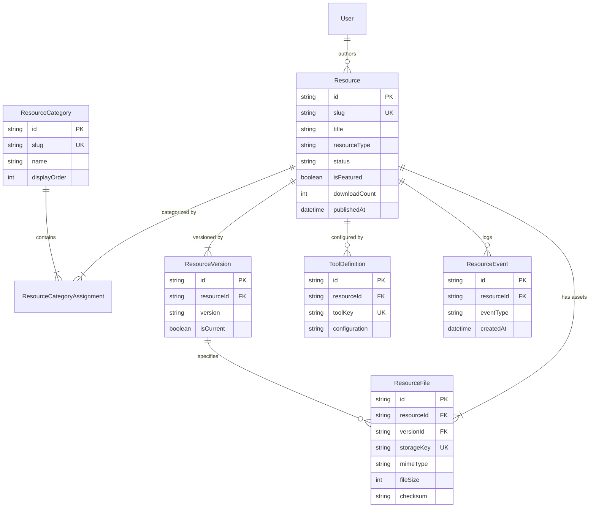

# SupplyIntelligence — Artifacts & Templates Architecture Audit & Design Document

**Document Version:** 1.0.0  
**Date:** 2026-11-04  
**Author:** Principal Full-Stack Software Engineer & System Architect  
**Target Module:** Artifacts & Templates Backend Foundation (Phase 1)  
**Status:** Approved for Implementation (Phase 1 Conditional Go)  

---

## 1. Executive Overview & Scope

This document details the architectural audit, system requirements, data modeling, API boundaries, security constraints, and migration strategy for the **Artifacts & Templates** module within the SupplyIntelligence platform.

### Phase 1 Narrow Scope Boundary
In accordance with the Phase 0 Independent Sign-Off (`qa-reports/PHASE_0_INDEPENDENT_SIGNOFF.md`), Phase 1 is strictly restricted to establishing the **Backend Foundation**:
- Database models and relational mappings in Prisma (PostgreSQL / SQLite).
- A domain service layer encapsulating resource lifecycle, versioning, categorization, and audit logging.
- Provider-neutral file storage foundation with MIME/file-signature validation and secure downloads.
- Public and administrative REST API contracts with role-based authorization.
- Resolution of remaining Phase 0 findings: author email disclosure remediation (SEC-02), cache control headers (SEC-03), and safe transition mapping for homepage toolkits (REG-02).
- Zero-mock automated test suite (`tsx --test`) covering service behavior, storage, security boundaries, and authorization.

**Strict Exclusions for Phase 1:** Full public Resource Library UI, Supplier Comparison Builder, Vendor Scorecard, Landed Cost Calculator, and dynamic XLSX/PDF generation engines belong to subsequent phases.

---

## 2. Existing System Architecture

### 2.1 Technology Stack Baseline
- **Application Framework:** Next.js 16.3.6 (App Router, Turbopack, React 19.3.0).
- **ORM & Data Layer:** Prisma 6.19.3.
- **Database Environments:**
  - *Production:* PostgreSQL (Neon serverless with pooled connection strings and unpooled migration URLs).
  - *Development:* SQLite (`prisma/dev.db`) for lightweight local iteration without cloud dependencies.
- **Authentication & Authorization:**
  - Auth.js v5 (`next-auth@5.0.0-beta.32`) utilizing stateless JWT sessions with role embedding.
  - Role Hierarchy: `VIEWER` (index 0) $\to$ `AUTHOR` (1) $\to$ `EDITOR` (2) $\to$ `ADMIN` (3) $\to$ `SUPER_ADMIN` (4) defined in [`lib/authorization.ts`](file:///c:/Users/Roshaan's%20Pc/Documents/Projects/Raza/supplyintelligence/lib/authorization.ts).
- **Styling & Components:** Tailwind CSS v4, `@base-ui/react`, Lucide React icons.

### 2.2 Existing Patterns & Reusable Services
1. **Database Singleton:** [`lib/db.ts`](file:///c:/Users/Roshaan's%20Pc/Documents/Projects/Raza/supplyintelligence/lib/db.ts) manages a shared global `prisma` client instance across Next.js reloads.
2. **Authorization Guards:** [`lib/authorization.ts`](file:///c:/Users/Roshaan's%20Pc/Documents/Projects/Raza/supplyintelligence/lib/authorization.ts) provides `checkAuth()` and `checkRole(minimumRole: Role)` for programmatic route handler protection.
3. **Service Layer Architecture:** Model-specific operations are isolated under `lib/services/` (e.g., [`lib/services/article.service.ts`](file:///c:/Users/Roshaan's%20Pc/Documents/Projects/Raza/supplyintelligence/lib/services/article.service.ts)), separating database queries, DTO transformations, and authorization boundaries from HTTP route handlers.
4. **HTML / Asset Sanitization:** [`lib/article-html.ts`](file:///c:/Users/Roshaan's%20Pc/Documents/Projects/Raza/supplyintelligence/lib/article-html.ts) utilizes `sanitize-html` to enforce strict input sanitization.

---

## 3. Database Architecture & Data Models

### 3.1 Logical Entities
To support procurement frameworks, operational templates, and interactive tools, the data layer introduces six interrelated entities:

1. **`Resource` (table: `resources`):**  
   The primary content entity. Represents a downloadable spreadsheet, document template, diagnostic matrix, or interactive calculator tool.
   - Types: `TEMPLATE`, `ARTIFACT`, `INTERACTIVE_TOOL`, `CALCULATOR`.
   - Lifecycle Statuses: `DRAFT` $\to$ `REVIEW` $\to$ `PUBLISHED` $\to$ `ARCHIVED`.
   - Fields: `id`, `title`, `slug` (unique), `description`, `resourceType`, `status`, `thumbnail`, `seoTitle`, `seoDescription`, `isFeatured`, `featuredOrder`, `downloadCount`, `viewCount`, `authorId`, timestamps.

2. **`ResourceCategory` (table: `resource_categories`):**  
   Taxonomy entity for organizing resources (e.g., "Strategic Sourcing", "Contract Management", "Supplier Risk", "Logistics & Freight").
   - Fields: `id`, `name`, `slug` (unique), `description`, `displayOrder`, timestamps.

3. **`ResourceCategoryAssignment` (table: `resource_category_assignments`):**  
   Many-to-many join entity allowing a single resource to belong to multiple categories when appropriate.
   - Primary Key: `[resourceId, categoryId]`.

4. **`ResourceVersion` (table: `resource_versions`):**  
   Maintains version history for resources as formulas, compliance guidelines, or formats change over time.
   - Fields: `id`, `resourceId`, `version` (e.g., "1.0.0"), `changelog`, `isCurrent`, `createdAt`, `publishedAt`.

5. **`ResourceFile` (table: `resource_files`):**  
   Stores binary asset metadata associated with a resource and specific version.
   - Allowed formats: Microsoft Excel (`.xlsx`), Microsoft Word (`.docx`), Adobe Portable Document Format (`.pdf`).
   - Fields: `id`, `resourceId`, `versionId`, `originalFilename`, `storageKey`, `mimeType`, `fileSize`, `checksum` (SHA-256), `isPrimary`, `createdAt`.

6. **`ToolDefinition` (table: `tool_definitions`):**  
   Configures interactive browser-based tools and calculators (e.g. schema definitions, default criteria, normalization rules for the Supplier Comparison engine).
   - Fields: `id`, `resourceId`, `toolKey`, `configuration` (JSON string), `schemaVersion`, `isActive`, timestamps.

7. **`ResourceEvent` (table: `resource_events`):**  
   Privacy-conscious event ledger capturing usage without tracking personally identifiable data.
   - Types: `VIEW`, `DOWNLOAD`, `TOOL_RUN`.
   - Fields: `id`, `resourceId`, `eventType`, `actorType` (`ANONYMOUS` / `USER`), `actorId`, `metadata` (JSON), `createdAt`.

### 3.2 Relational Entity Diagram



---

## 4. File Storage Architecture

### 4.1 Storage Strategy & Neutral Abstraction
File storage must never rely on ephemeral local container storage for production persistence. A provider-neutral abstraction [`StorageProvider`](file:///c:/Users/Roshaan's%20Pc/Documents/Projects/Raza/supplyintelligence/lib/storage/types.ts) decouples application logic from storage infrastructure:

```typescript
export interface StorageProvider {
  upload(file: { filename: string; buffer: Buffer; mimeType: string }): Promise<{ storageKey: string; checksum: string; fileSize: number }>
  download(storageKey: string): Promise<{ stream: NodeJS.ReadableStream | Buffer; mimeType: string; filename?: string; fileSize: number } | null>
  delete(storageKey: string): Promise<boolean>
  exists(storageKey: string): Promise<boolean>
}
```

### 4.2 Storage Implementations
1. **`LocalStorageProvider` (Local Development & Testing):**
   - Stores files in a secured directory outside the public web root (`storage/resources/`).
   - Enforces path containment to prevent path traversal attacks (`../`).
2. **`S3StorageProvider` (Production AWS S3 / Cloudflare R2 / Neon Object Storage):**
   - Configured via `S3_BUCKET_NAME`, `S3_REGION`, `S3_ACCESS_KEY_ID`, `S3_SECRET_ACCESS_KEY`.
   - When production environment variables are not supplied, the storage factory safely falls back to local storage while logging an operational warning.

### 4.3 Upload Security & File Signature Verification
Untrusted uploads are protected by four distinct verification gates:
1. **Extension Allowlist:** Only `.xlsx`, `.docx`, and `.pdf` extensions are accepted.
2. **MIME Type Allowlist:**
   - `.xlsx`: `application/vnd.openxmlformats-officedocument.spreadsheetml.sheet`
   - `.docx`: `application/vnd.openxmlformats-officedocument.wordprocessingml.document`
   - `.pdf`: `application/pdf`
3. **Magic Byte / File Signature Validation:**
   - PDF files must begin with `%PDF-` (`0x25 0x50 0x44 0x46`).
   - Office OpenXML files (`.xlsx`, `.docx`) must begin with the PK zip header (`0x50 0x4B 0x03 0x04`).
   - Files failing signature inspection are immediately rejected with HTTP 400 Bad Request.
4. **Integrity & Checksum:** A SHA-256 cryptographic digest is computed on upload and stored in the database for tamper detection.
5. **Malware Strategy:** File uploads must pass through a pluggable scanner interface before being marked active. In production, files can be stored with a `PENDING_SCAN` quarantine status before release.

---

## 5. API Boundaries & Security Architecture

### 5.1 Public Endpoints
- `GET /api/resources`
  - Returns paginated list of `PUBLISHED` resources.
  - Supports filters: `category`, `type`, `search`, `featured`.
  - Serializes safe public DTOs via `toPublicResource()`. Excludes internal storage keys, drafts, and administrative audit trails.
  - Cache policy: `Cache-Control: public, max-age=60, s-maxage=300, stale-while-revalidate=600`.
- `GET /api/resources/[id]`
  - Resolves resource by CUID or unique slug.
  - If resource status $\neq$ `PUBLISHED`, unauthenticated callers receive **HTTP 404 Not Found** (preventing resource enumeration).
  - Cache policy: `Cache-Control: public, max-age=60, s-maxage=300`.
- `GET /api/resources/[id]/download`
  - Validates publication status.
  - Verifies binary asset presence.
  - Records an asynchronous `DOWNLOAD` event in `ResourceEvent` and increments `downloadCount`.
  - Sets safe download headers:
    - `Content-Disposition: attachment; filename="<sanitized_filename>"`
    - `Content-Type: <mimeType>`
    - `Cache-Control: private, no-transform`

### 5.2 Administrative Endpoints (`/api/admin/resources/*`)
Administrative routes enforce role-based access control via [`checkRole('EDITOR')`](file:///c:/Users/Roshaan's%20Pc/Documents/Projects/Raza/supplyintelligence/lib/authorization.ts):
- `GET /api/admin/resources` — Paginated list of all resources across all statuses.
- `POST /api/admin/resources` — Create new resource in `DRAFT` status.
- `GET /api/admin/resources/[id]` — View full resource with all versions, files, and audit metadata.
- `PUT /api/admin/resources/[id]` — Update metadata.
- `DELETE /api/admin/resources/[id]` — Soft-delete / archive resource.
- `POST /api/admin/resources/[id]/publish` — Validate and transition publication status (`DRAFT` $\to$ `REVIEW` $\to$ `PUBLISHED` $\to$ `ARCHIVED`). Rejects invalid backwards transitions without review.
- `POST /api/admin/resources/[id]/files` — Handle authenticated multipart file upload.
- `POST /api/admin/resources/[id]/versions` — Bump resource version and log changelog.
- Cache policy on all admin endpoints: `Cache-Control: private, no-cache, no-store, max-age=0, must-revalidate`.

---

## 6. Resolution of Phase 0 Conditional Findings

### 6.1 SEC-02: Public Author Email Exposure
- **Finding:** Anonymous requests to `/api/articles` received author email addresses because `SAFE_USER_SELECT` included `email: true`.
- **Phase 1 Remediation:**
  - Introduced `PUBLIC_USER_SELECT` in [`lib/services/article.service.ts`](file:///c:/Users/Roshaan's%20Pc/Documents/Projects/Raza/supplyintelligence/lib/services/article.service.ts):
    ```typescript
    export const PUBLIC_USER_SELECT = {
      id: true,
      name: true,
      avatar: true,
      role: true,
    } as const
    ```
  - `toPublicArticle()` and unauthenticated queries explicitly select `PUBLIC_USER_SELECT`, ensuring author email addresses are completely omitted from public responses.
  - `SAFE_USER_SELECT` (including email) is reserved for authenticated administrative and editorial workflows.

### 6.2 SEC-03: Response Cache Control
- Explicit `Cache-Control` headers are applied across all API route handlers:
  - Public article and resource GET endpoints emit caching headers allowing CDN caching with stale-while-revalidate.
  - Unauthenticated draft access attempts, authenticated admin routes, mutations, and user profiles emit `Cache-Control: private, no-store`.

### 6.3 REG-02: Strategic Toolkits Safe Transition Roadmap
- The homepage cards in `StrategicToolkits.tsx` currently point to active published articles as a temporary fallback to eliminate 404 errors.
- **Phase 1 Strategy:** Preserve the working article routes to avoid breaking live user navigation.
- **Phase 2 Transition Plan:** Once Phase 1 backend models and storage are verified, seed the database with the three matching resources (`strategic-sourcing-7-step-maturity-matrix`, `multi-tier-supplier-disruption-scorecard`, `enterprise-ai-procurement-roadmap`) in Phase 2 and cleanly repoint the cards to `/resources/<slug>`.

---

## 7. Migration & Database Deployment Strategy

1. **Schema Migration:**  
   - Generated standard PostgreSQL DDL migration: `prisma/migrations/20261104190000_add_artifacts_templates/migration.sql`.
   - Applied DDL tables to local SQLite development database to ensure local parity.
2. **Zero Downtime & Backward Compatibility:**  
   - All newly introduced tables are strictly additive.
   - Zero modifications to existing tables (`users`, `articles`, `categories`, `sessions`).
   - Existing article and dashboard routes operate without disruption.
3. **Rollback Plan:**  
   If rollback is required, drop the seven newly created tables:
   ```sql
   DROP TABLE IF EXISTS "resource_events";
   DROP TABLE IF EXISTS "tool_definitions";
   DROP TABLE IF EXISTS "resource_files";
   DROP TABLE IF EXISTS "resource_versions";
   DROP TABLE IF EXISTS "resource_category_assignments";
   DROP TABLE IF EXISTS "resource_categories";
   DROP TABLE IF EXISTS "resources";
   ```

---

## 8. Verification & Acceptance Criteria

To satisfy Phase 1 completion, the backend must meet all verification gates:
- `npx prisma validate` $\to$ Exit Code 0.
- `npm run typecheck` $\to$ Exit Code 0.
- `npm run lint` $\to$ Exit Code 0.
- `npm test` $\to$ Exit Code 0 with 100% passing tests covering service operations, storage, and security.
- `npm run build` $\to$ Exit Code 0 (Turbopack production build succeeds).
- Runtime smoke tests confirm 401 rejections on unauthorized admin mutations, sanitized public responses, and verified file download streams.

